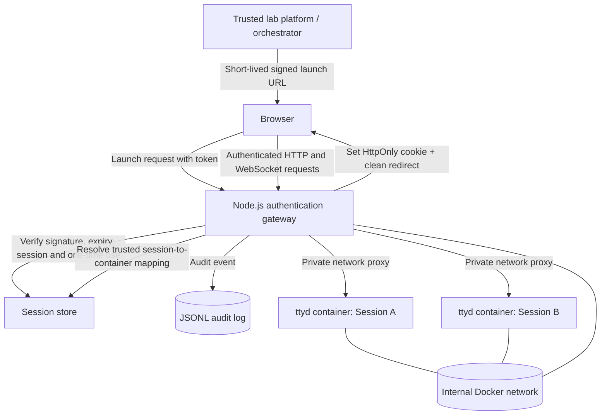

<div align="center">

# 🔐 Secure, Authenticated Browser-Based Terminal Access

### A session-isolated browser terminal with signed launch credentials, a Node.js gateway, and Docker-backed `ttyd` environments

**Project type:** Cybersecurity / Web Security / Container Isolation  
**Runtime:** Node.js 22 · Docker · Docker Compose  
**Status:** Functional prototype with automated tests and local security checks

</div>

---

## Table of contents

- [1. Overview](#1-overview)
- [2. Problem statement](#2-problem-statement)
- [3. Objectives](#3-objectives)
- [4. Key features](#4-key-features)
- [5. Technology stack](#5-technology-stack)
- [6. Architecture](#6-architecture)
- [7. Authentication and session lifecycle](#7-authentication-and-session-lifecycle)
- [8. Security controls](#8-security-controls)
- [9. Project structure](#9-project-structure)
- [10. Prerequisites](#10-prerequisites)
- [11. Local setup](#11-local-setup)
- [12. Configuration reference](#12-configuration-reference)
- [13. Running the project](#13-running-the-project)
- [14. Administrative API](#14-administrative-api)
- [15. Testing and verification](#15-testing-and-verification)
- [16. Observed test results](#16-observed-test-results)
- [17. Audit logging](#17-audit-logging)
- [18. Threat model and design decisions](#18-threat-model-and-design-decisions)
- [19. Limitations and production-hardening roadmap](#19-limitations-and-production-hardening-roadmap)
- [20. Troubleshooting](#20-troubleshooting)
- [21. Responsible use](#21-responsible-use)

---

## 1. Overview

Secure, Authenticated Browser-Based Terminal Access is a prototype for providing learners with terminal access directly in a web browser without exposing each terminal as a publicly reachable service or prompting users for a separate native terminal login.

A trusted Node.js gateway authenticates each request and routes it to the correct `ttyd` terminal running in its own Docker container. A short-lived, signed launch credential is redeemed once; the gateway then issues an `HttpOnly` session cookie and redirects the browser to a clean URL. The gateway authenticates subsequent HTTP requests and WebSocket upgrades before proxying them to the session's private terminal.

The design aims to make lab access convenient while keeping the trust boundary on the gateway and separating terminal containers from the host and from one another.

> **Project status:** The core flow has been run locally. Automated token, gateway, isolation, and session-expiry tests pass. The security checks documented below are evidence for this prototype, not a claim of a production security certification or a comprehensive penetration test.

## 2. Problem statement

Browser-based lab platforms often need to launch command-line environments with minimal friction. Directly exposing terminal ports or relying on a shared password can create avoidable risks:

- A terminal service may be reachable independently of the lab platform's authentication.
- Reusable credentials can be copied or shared.
- Guessable or discoverable terminal ports can become an alternate path to a shell.
- One learner's terminal may accidentally share state or resources with another learner.
- Session termination and suspicious access attempts may be difficult to audit.

This project explores a gateway-mediated design in which the browser receives a short-lived launch link, the gateway validates it, and each lab session is routed to a private, isolated terminal container.

## 3. Objectives

1. **One-click access:** open a browser terminal from a trusted launch link without a native browser authentication dialog.
2. **Short-lived launch credentials:** sign launch tokens with HMAC-SHA-256, validate their expiry, and consume each launch token only once.
3. **Authenticated proxying:** validate HTTP requests and WebSocket upgrades before connecting to a terminal.
4. **Session isolation:** create a separate Docker terminal container for each session.
5. **Revocation and expiry:** reject inactive, expired, and revoked sessions and terminate their containers.
6. **Auditability:** record security-relevant outcomes in JSON Lines format without intentionally logging raw token values.
7. **Container hardening:** avoid published terminal ports, use a non-root terminal user, remove Linux capabilities, use a read-only root filesystem, and apply resource limits.
8. **Testability:** exercise token validation, one-time redemption, isolation behavior, and session expiry with repeatable automated tests.

## 4. Key features

- HMAC-SHA-256 signed launch and session tokens.
- Random token identifier (`jti`) to support one-time launch redemption.
- Short-lived launch URL followed by a clean redirect.
- `HttpOnly` and `SameSite=Strict` session cookie.
- Authentication checks on HTTP requests and WebSocket upgrades.
- Per-session `ttyd` Docker container.
- Internal Docker network for terminal containers.
- No host-published ports for individual terminal containers.
- Container restrictions: non-root UID/GID, read-only root filesystem, dropped capabilities, `no-new-privileges`, PID/memory/CPU limits, and a restricted `/tmp` tmpfs.
- Session status tracking and explicit revocation.
- JSONL audit events with timestamps and token fingerprints.
- Automated tests using Node.js's built-in test runner.

## 5. Technology stack

| Technology | Role |
|---|---|
| **Node.js** | Gateway, token validation, session orchestration, HTTP/WebSocket proxying |
| **JavaScript (CommonJS)** | Application and test implementation |
| **Docker Engine API** | Creates, starts, inspects, stops, and removes terminal containers |
| **Docker Compose** | Defines gateway deployment, networks, volumes, health check, and resource limits |
| **`ttyd`** | Exposes a shell through a browser-compatible terminal protocol |
| **HMAC-SHA-256** | Signs and verifies terminal tokens |
| **Node.js `crypto`** | Random UUIDs, HMAC, SHA-256 fingerprints, timing-safe signature comparison |
| **Node.js `node:test`** | Automated unit and integration-style tests |
| **PowerShell** | Local setup and verification on Windows |
| **JSON Lines (JSONL)** | Append-only structured audit-event format |

The project uses Node.js built-in modules for its application and test code. Docker Desktop is required for the real container-backed flow.

## 6. Architecture

### High-level component diagram



### Network and trust boundaries

```text
Host / Docker Engine
│
├── Published host port: 8080
│   └── terminal-gateway (trusted component)
│       ├── authentication and token validation
│       ├── session-to-container mapping
│       ├── audit writer
│       └── Docker Engine API access
│
├── frontend Docker network
│   └── gateway
│
└── terminal-internal Docker network (internal)
    ├── gateway
    ├── terminal container A (ttyd on container port 7681)
    ├── terminal container B (ttyd on container port 7681)
    └── terminal container N ...
```

Only the gateway's port is published to the host. A terminal's `7681/tcp` declaration is an internal container port, not a host port mapping. The gateway stores the trusted session-to-container target; browser-supplied data does not choose the container image, command, host, port, or Docker settings.

### Request flow

1. The trusted orchestrator creates a lab session and asks the gateway to create its terminal container.
2. The gateway returns a URL containing a short-lived signed launch token.
3. The browser requests that URL.
4. The gateway verifies the token signature, type, expiry, session status, and one-time-use identifier.
5. If valid, the gateway issues a session cookie and redirects to the same path without the launch token in the URL.
6. The browser requests terminal assets and opens its WebSocket connection using the cookie.
7. The gateway validates each request and proxies it to the terminal's private address.
8. On revocation or expiry, the gateway denies further authorization and terminates the container; tracked WebSocket connections are closed during explicit termination.

## 7. Authentication and session lifecycle

### Token design

The token payload contains fields including:

- `sid`: session identifier.
- `typ`: token type (`launch` or `session`).
- `exp`: token expiration time in Unix seconds.
- `jti`: random token identifier used for one-time launch redemption.
- `lab`: lab expiry value carried by the launch token.

The payload is Base64URL-encoded and signed with HMAC-SHA-256. Signature comparison uses a timing-safe comparison. A SHA-256 fingerprint, truncated to 16 hexadecimal characters, is used for audit correlation instead of intentionally logging the raw token.

### Launch token versus session cookie

| Credential | Purpose | Lifetime / behavior |
|---|---|---|
| Launch token | Redeem a trusted launch link | Short-lived (60 seconds in the token URL helper) and single-use |
| Session cookie | Authorize subsequent terminal HTTP and WebSocket requests | Bounded by the remaining lab-session lifetime |
| Admin key | Protect session-management endpoints | Long random secret supplied through environment configuration |

The cookie is configured as `HttpOnly` and `SameSite=Strict`. The `Secure` attribute is controlled by configuration. For local HTTP development it may be disabled; production deployment should use HTTPS and secure cookies.

### Session states

The in-memory store uses states such as:

- `creating`
- `active`
- `failed`
- `revoked`
- `expired`

The store checks the expiry time before authorizing a session. Expired sessions are marked `expired` and denied. Revocation transitions an active or creating session to the requested termination reason and records a termination timestamp.

## 8. Security controls

| Control | Implementation intent |
|---|---|
| Signed launch credentials | HMAC-SHA-256 signature validation |
| Token expiry | `exp` validation; session expiry checked separately |
| Replay prevention | A consumed launch `jti` cannot be redeemed again within the in-memory store's lifetime |
| Cookie protection | `HttpOnly`, `SameSite=Strict`; `Secure` in HTTPS deployments |
| HTTP authentication | Gateway validates the request before proxying |
| WebSocket authentication | Upgrade handler validates session credentials and origin before upstream connection |
| Private terminal access | Terminal containers use the internal Docker network |
| No direct host terminal ports | Container `PortBindings` are empty |
| Container privilege reduction | Non-root `1000:1000`, `CapDrop: ALL`, `no-new-privileges:true` |
| Filesystem restriction | Terminal root filesystem is read-only |
| Resource constraints | Terminal defaults: 256 MiB memory, 0.5 CPU, 128 PIDs; `/tmp` uses a 64 MiB `noexec,nosuid` tmpfs |
| Gateway container hardening | Compose configuration sets read-only root filesystem, drops capabilities, limits resources, and uses a health check |
| Audit trail | JSONL records for accepted/rejected requests, session creation, and termination |
| Rate limiting | Repeated authentication failures are limited per remote IP in the gateway process |

These controls reduce risk but do not eliminate it. In particular, Docker socket access is highly privileged and must be treated as host-level administrative access.

## 9. Project structure

```text
Secure, Authenticated Terminal Access/
├── src/
│   ├── multi-user-gateway.js   # Main multi-user auth gateway and proxy
│   ├── gateway.js              # Earlier/single-gateway implementation
│   ├── session-manager.js      # Docker container lifecycle and limits
│   ├── session-store.js        # In-memory session/replay state
│   ├── docker-client.js        # Docker Engine API client
│   └── token.js                # HMAC token creation, verification, URL helper
├── test/
│   ├── token.test.js           # Token signing, expiry and type validation
│   ├── gateway.test.js         # Launch redemption and gateway behavior
│   ├── isolation.test.js       # Separate sessions and revocation behavior
│   └── session-expiry.test.js  # Expired-session store behavior
├── scripts/
│   ├── benchmark.js            # Lightweight benchmark utility
│   ├── verify-paths.js         # Required-file and npm-script path checks
│   ├── package-check.js        # Rejects local .env files in a package tree
│   └── package-project.ps1     # Packaging helper for Windows
├── docs/
│   └── design.md               # Design notes and acceptance checks
├── logs/                       # Local JSONL audit output (do not submit live logs)
├── Dockerfile                  # Gateway image definition
├── docker-compose.yml          # Gateway, networks, volumes, health check
├── .env.example                # Safe configuration template
├── .gitignore                  # Ignores local secrets, logs, and node_modules
├── package.json                # Scripts and Node.js engine requirement
└── README.md
```

> The tree above describes the intended/current working project layout. Keep `test/session-expiry.test.js` in the final project because it was added during verification. Do not package local `.env`, live logs, or `node_modules`.

## 10. Prerequisites

- Windows 10/11, macOS, or Linux.
- Node.js **20 or newer** (the project was tested locally with Node.js `v22.15.0`).
- Docker Desktop on Windows/macOS, or Docker Engine on Linux.
- Docker Compose v2 (`docker compose` command).
- A terminal with permission to access Docker.
- The configured terminal image available locally or downloadable by Docker.

Check the installed tools:

```powershell
node --version
npm --version
docker --version
docker compose version
docker info
```

On Windows, start Docker Desktop and wait until the Docker engine is running before starting the project.

## 11. Local setup

### 11.1 Obtain the project

Extract the project archive into a working directory, for example:

```text
C:\Users\<your-user>\Projects\Secure, Authenticated Terminal Access
```

Open PowerShell in that directory.

### 11.2 Create local configuration

Copy the example file:

```powershell
Copy-Item .env.example .env
```

Generate two different random secrets. Run the following command twice and use one output for each secret:

```powershell
node -e "console.log(require('crypto').randomBytes(32).toString('hex'))"
```

Edit `.env` and replace the placeholder values for:

- `TERMINAL_TOKEN_SECRET`
- `ADMIN_KEY`

Do not use the same value for both. Do not share `.env`, commit it, or include it in a submission archive.

### 11.3 Configure the Docker network

The Compose-created internal network is normally named `<compose-project>_terminal-internal`. The `TERMINAL_NETWORK` value in `.env` must match the actual network name used by Docker Compose.

Check the network name with:

```powershell
docker network ls
```

For the project folder name used in local verification, the network was:

```text
secureauthenticatedterminalaccess_terminal-internal
```

If the Compose project name changes, update the setting to match the newly created network.

### 11.4 Start the gateway

```powershell
docker compose up -d --build
docker compose ps
docker compose logs --tail 100 terminal-gateway
```

Check the health endpoint:

```powershell
Invoke-WebRequest -Uri http://localhost:8080/healthz
```

A healthy response should return HTTP 200 and `ok`.

### Local Docker socket note

The gateway needs Docker Engine API access to create terminal containers. On the local Windows Docker Desktop setup, socket/permission behavior may require environment-specific configuration. A local development workaround such as adding the gateway to a highly privileged group is **not** a production security recommendation. Never expose the Docker socket to learner containers.

## 12. Configuration reference

The values below are a reference. Use the actual `.env.example` distributed with your project as the starting point and replace all secret placeholders.

| Variable | Purpose | Typical local value / default |
|---|---|---|
| `PORT` | Gateway HTTP port | `8080` |
| `ADMIN_PORT` | Legacy/alternate gateway configuration setting | `9090` |
| `TERMINAL_TOKEN_SECRET` | HMAC signing secret | Random secret, at least 32 characters |
| `ADMIN_KEY` | Admin API authentication key | Different random secret, at least 32 characters |
| `SESSION_TTL_SECONDS` | Lab session lifetime | `3600` |
| `LAUNCH_TTL_SECONDS` | Launch-token lifetime setting | `60` |
| `MAX_ACTIVE_SESSIONS` | Maximum active sessions in one gateway process | `10` |
| `TERMINAL_IMAGE` | Docker image for `ttyd` | `tsl0922/ttyd:1.7.7` |
| `TERMINAL_NETWORK` | Private network used by terminal containers | Compose-created `terminal-internal` network |
| `TERMINAL_COMMAND` | Command passed to the terminal container | `ttyd -W --max-clients 1 bash` |
| `AUDIT_LOG_PATH` | JSONL audit log location | `./logs/terminal-access.jsonl` |
| `DOCKER_SOCKET` | Docker Engine socket path | `/var/run/docker.sock` in the container |
| `ALLOWED_ORIGINS` | Allowed browser origin(s), comma-separated | `http://localhost:8080` |
| `COOKIE_SECURE` | Whether to set the cookie `Secure` attribute | `false` for local HTTP only; `true` with HTTPS |
| `FRAME_ANCESTORS` | CSP `frame-ancestors` value | `'self'` |
| `TTYD_HOST` / `TTYD_PORT` | Settings used by the alternate gateway implementation | `127.0.0.1` / `7681` |

**Important:** The multi-user gateway currently uses `SESSION_TTL_SECONDS`, `LAUNCH_TTL_SECONDS`, `MAX_ACTIVE_SESSIONS`, `TERMINAL_IMAGE`, `TERMINAL_NETWORK`, and `TERMINAL_COMMAND` directly. Some settings listed above are also used by the alternate `src/gateway.js` implementation or are legacy configuration. Verify configuration use in the selected entry point before relying on a setting in deployment.

## 13. Running the project

### Start

```powershell
docker compose up -d --build
```

### View gateway logs

```powershell
docker compose logs -f terminal-gateway
```

### View running containers

```powershell
docker ps --format "table {{.Names}}\t{{.Ports}}\t{{.Networks}}"
```

Expected topology: the gateway publishes port `8080`; terminal containers show their internal terminal port (typically `7681/tcp`) but no host port mapping.

### Stop the gateway stack

```powershell
docker compose down
```

This stops the Compose-managed gateway. Depending on the lifecycle and state of separately created terminal containers, verify and clean up remaining project-managed containers before shutting down or deleting the working directory.

## 14. Administrative API

The multi-user gateway protects `/admin/` endpoints with the `x-admin-key` HTTP header.

| Method | Path | Purpose | Expected behavior |
|---|---|---|---|
| `POST` | `/admin/sessions` | Create a terminal session | Returns HTTP 201 with a session ID and launch URL |
| `GET` | `/admin/sessions/{uuid}` | Read session status | Returns the stored session record or HTTP 404 if unknown |
| `DELETE` | `/admin/sessions/{uuid}` | Revoke/terminate a session | Returns HTTP 204 on successful termination |
| `GET` | `/healthz` | Health check | Returns `ok` |

Example PowerShell session creation (do not print or share the launch URL):

```powershell
# Load ADMIN_KEY from the local .env file without displaying it.
$adminLine = Get-Content .env |
  Where-Object { $_ -match '^ADMIN_KEY=' } |
  Select-Object -First 1

if (-not $adminLine) { throw "ADMIN_KEY not found in .env" }

$adminKey = $adminLine.Substring('ADMIN_KEY='.Length).Trim().Trim('"').Trim("'")
$headers = @{ 'x-admin-key' = $adminKey }

$session = Invoke-RestMethod `
  -Method Post `
  -Uri 'http://localhost:8080/admin/sessions' `
  -Headers $headers

# Open the launch URL directly without printing it to the console.
Start-Process $session.launchUrl
```

Example revocation using a known test session ID:

```powershell
Invoke-WebRequest `
  -Method Delete `
  -Uri "http://localhost:8080/admin/sessions/<SESSION-UUID>" `
  -Headers $headers
```

Replace `<SESSION-UUID>` with the ID returned when creating the test session. Treat the admin key and launch URL as credentials. Do not include them in screenshots, reports, or logs.

## 15. Testing and verification

The project uses the built-in Node.js test runner. No separate test framework is required.

### Run all automated tests

```powershell
npm test
```

### Run token and gateway security tests

```powershell
npm run test:security
```

### Run isolation test

```powershell
npm run test:isolation
```

### Run gateway and isolation integration tests

```powershell
npm run test:integration
```

### Check JavaScript syntax

```powershell
npm run check
```

### Check project paths and packaging exclusions

```powershell
npm run package:check
```

The package check intentionally fails if it finds `.env` or `.env.local` in the directory being checked. Run it from a clean submission copy that excludes local secrets, logs, and `node_modules`. Do not remove the safeguard just to make the check pass.

### Manual security checks performed during local verification

The following checks were performed against the local Docker deployment:

1. A request to `http://localhost:8080/` without credentials returned **HTTP 401**.
2. A WebSocket upgrade request without a session cookie or launch token returned **HTTP 401**.
3. `docker ps` showed the gateway publishing `8080`, while the observed terminal containers had no host port mappings and were attached to the internal terminal network.
4. A revoked session returned HTTP 204 from the DELETE endpoint, its record subsequently showed `status: revoked`, and the corresponding container ID was no longer listed by `docker ps -a`.
5. The JSONL log contained events such as `missing-token`, `accepted-websocket`, `replayed-token`, `revoked-session`, `session-created`, and `session-terminated`.
6. A DNS lookup from a temporary container on the internal network returned `SERVFAIL`. This is a limited observation, not proof that every form of outbound traffic is blocked.
7. The terminal container inspected during verification used user `1000:1000`, a read-only root filesystem, dropped capabilities, `no-new-privileges`, no mounts, no published ports, and resource limits.

## 16. Observed test results

The following results were observed during local development after adding `test/session-expiry.test.js`.

### Complete test suite

```text
✔ launch token is consumed once and redirected without a token
✔ two sessions remain isolated and revoking A preserves B
✔ expired sessions are denied and marked expired
✔ issues and verifies a session token
✔ rejects expired, modified and absent tokens
✔ rejects wrong token type
ℹ tests 6
ℹ pass 6
ℹ fail 0
ℹ cancelled 0
ℹ skipped 0
```

### Security tests

```text
✔ launch token is consumed once and redirected without a token
✔ issues and verifies a session token
✔ rejects expired, modified and absent tokens
✔ rejects wrong token type
ℹ tests 4
ℹ pass 4
ℹ fail 0
```

### Isolation test

```text
✔ two sessions remain isolated and revoking A preserves B
ℹ tests 1
ℹ pass 1
ℹ fail 0
```

### Integration tests

```text
✔ launch token is consumed once and redirected without a token
✔ two sessions remain isolated and revoking A preserves B
ℹ tests 2
ℹ pass 2
ℹ fail 0
```

### Session-expiry test

```text
✔ expired sessions are denied and marked expired
ℹ tests 1
ℹ pass 1
ℹ fail 0
```

### Syntax and packaging checks

- `npm run check`: passed.
- `npm run package:check` in the original working directory: path verification passed, then package check correctly failed because the real `.env` file was present. The clean-copy packaging check must be run separately.

### Important test-scope qualification

The gateway and isolation tests use simulated upstream HTTP servers. The session-expiry test uses a simulated clock. They are valuable automated tests, but they do not prove every property of real Docker-backed sessions or substitute for a comprehensive penetration test. The live checks above were manual checks performed in the local development environment.

## 17. Audit logging

Audit events are written as JSON Lines to the configured `AUDIT_LOG_PATH`. Each line is an independent JSON object, which makes it easy to inspect or ingest into a log pipeline.

Observed event types include:

- `accepted-launch`
- `accepted-websocket`
- `missing-token`
- `expired-token`
- `replayed-token`
- `revoked-session`
- `session-created`
- `session-terminated`
- `container-start-failed`
- `admin-operation-failed`

Typical event fields include `at`, `outcome`, `method`, `path`, `remoteIp`, `reason`, `containerId`, and pseudonymous `tokenId` / `sessionId` fingerprints, depending on the event.

Inspect recent event types without dumping credentials:

```powershell
Get-Content .\logs\terminal-access.jsonl |
  ForEach-Object {
    try { $_ | ConvertFrom-Json } catch {}
  } |
  Select-Object -Last 20 -Property at, outcome, method, path, reason |
  Format-Table -AutoSize
```

The fingerprint function hashes the token with SHA-256 and retains the first 16 hexadecimal characters. A fingerprint is still a correlation identifier and should be handled as potentially sensitive metadata. Avoid logging raw launch URLs, cookies, admin keys, or complete authorization headers.

Local logs may contain IP addresses, container IDs, session metadata, and access patterns. Do not include real development logs in a public repository or assignment archive.

## 18. Threat model and design decisions

### In scope

- Unauthorized users attempting to access a terminal without a valid credential.
- Reuse of a launch link after its one-time redemption.
- Modified or expired token attempts.
- Attempts to access a terminal over an unauthenticated WebSocket.
- Accidental direct exposure of terminal container ports.
- Accidental sharing of session targets between users.
- Basic container privilege and resource reduction.
- Auditing of important authentication and lifecycle events.

### Assumptions

- The orchestrator and gateway host are trusted.
- The admin key and token-signing secret remain confidential.
- Docker Engine and the host kernel are trusted.
- TLS is provided for production browser access.
- Learner workloads may be untrusted and should not be given access to the Docker socket or host mounts.

### Out of scope / not yet proven

- Full resistance to container escapes or host-kernel vulnerabilities.
- Production-grade high availability or multi-replica session coordination.
- Complete egress blocking verified across all protocols and IP-level paths.
- Formal penetration testing, fuzzing, and load testing.
- Durable revocation and replay state across gateway restarts.
- Centralized audit retention, tamper resistance, alerting, and compliance controls.

## 19. Limitations and production-hardening roadmap

This is a working prototype, not a production-ready multi-tenant service. The following improvements should be addressed before deployment with untrusted users.

### Priority 1: Docker privilege boundary

The gateway needs Docker Engine API access to create containers. Access to the Docker socket is effectively host-administrative power. Keep it limited to a trusted component and never mount it into terminal containers. A production architecture should isolate orchestration privileges, consider a narrowly scoped container-management service, and review host-level controls.

### Priority 2: Durable session and replay state

`MemorySessionStore` keeps sessions and consumed launch-token IDs in process memory. A gateway restart loses this state, and multiple replicas would not share it. Use a shared store such as Redis with authenticated TLS and atomic operations before supporting multiple replicas or durable revocation.

### Priority 3: Expiry cleanup and WebSocket lifecycle

Authorization checks reject expired sessions, and a periodic cleanup calls `cleanupExpired()`. Validate the complete expiry lifecycle against real Docker containers, including active WebSocket closure, container removal, and behavior after gateway restarts.

### Priority 4: Network egress verification

The internal Compose network is configured with `internal: true`, and a DNS lookup returned `SERVFAIL` in local testing. Perform dedicated network tests for IPv4/IPv6, direct-IP connections, DNS, and access to host services before claiming complete egress isolation.

### Priority 5: TLS and browser deployment

Use HTTPS in production, enable `COOKIE_SECURE=true`, configure trusted origins precisely, and ensure the reverse proxy does not log launch URLs containing credentials. The default `http://localhost:8080` origin is for local development.

### Priority 6: Image and command validation

Pin the terminal image to a verified immutable digest, scan it, validate the `ttyd` command and non-root compatibility, and keep the image and dependencies updated.

### Priority 7: Audit operations

Ship JSONL events to a protected central logging system, restrict log access, define retention, monitor repeated failures, and prevent logs from becoming a source of credential or personal-data leakage.

### Priority 8: Broader security validation

Add live Docker end-to-end tests for expired sessions, revoked sessions, concurrent sessions, WebSocket teardown, container cleanup, restart behavior, and direct access attempts. Run dependency, configuration, and container image scans before a production release.

## 20. Troubleshooting

### Gateway doesn't start: signing secret is too short

The gateway requires `TERMINAL_TOKEN_SECRET` and `ADMIN_KEY` to be at least 32 characters. Generate two separate random values and update `.env`. Never paste the values into chat or a public issue.

### Session creation fails

Check:

```powershell
docker compose ps
docker compose logs --tail 100 terminal-gateway
docker network ls
docker image ls
```

Verify that the configured `TERMINAL_IMAGE` exists and that `TERMINAL_NETWORK` matches the actual Compose-created internal network. Review the gateway audit log for a `container-start-failed` event without publishing secrets.

### Browser shows “terminal authentication required”

- Create a fresh launch session.
- Open the full launch URL directly from the returned value; don't manually copy a truncated console/table representation.
- Launch tokens are single-use and expire quickly. Don't reuse an old link.
- Check the browser origin and `ALLOWED_ORIGINS` configuration.
- Review the audit event outcome, but do not paste the full launch URL or token into a report.

### Terminal can't reach a writable directory

The root filesystem is read-only by design. `/tmp` is provided as a restricted temporary filesystem. Do not disable read-only mode merely to make arbitrary writes succeed without considering the security trade-off.

### `npm run package:check` reports `.env`

This is expected in the original development directory. The check deliberately rejects `.env` and `.env.local`. Create a clean submission copy that excludes those files, local logs, and `node_modules`, then run the check from that copy. Keep `.env.example` as the safe template.

### Terminal containers remain after testing

Inspect project-managed containers before removing anything:

```powershell
docker ps -a --format "table {{.ID}}\t{{.Names}}\t{{.Status}}\t{{.Ports}}"
```

Prefer revoking sessions through the authenticated admin API. Do not use broad `docker rm -f $(docker ps -aq)` commands on a machine that may host unrelated containers.

## 21. Responsible use

This project is intended for authorized labs, education, and controlled security testing. Do not expose the service publicly without a security review. Keep administrative credentials private, avoid distributing real audit logs, and do not run untrusted workloads on a host whose Docker control plane is accessible to the gateway without appropriate isolation.

---

<div align="center">

**Secure, Authenticated Browser-Based Terminal Access**  
*One-click lab access · Authenticated proxying · Isolated containers · Auditable sessions*

</div>