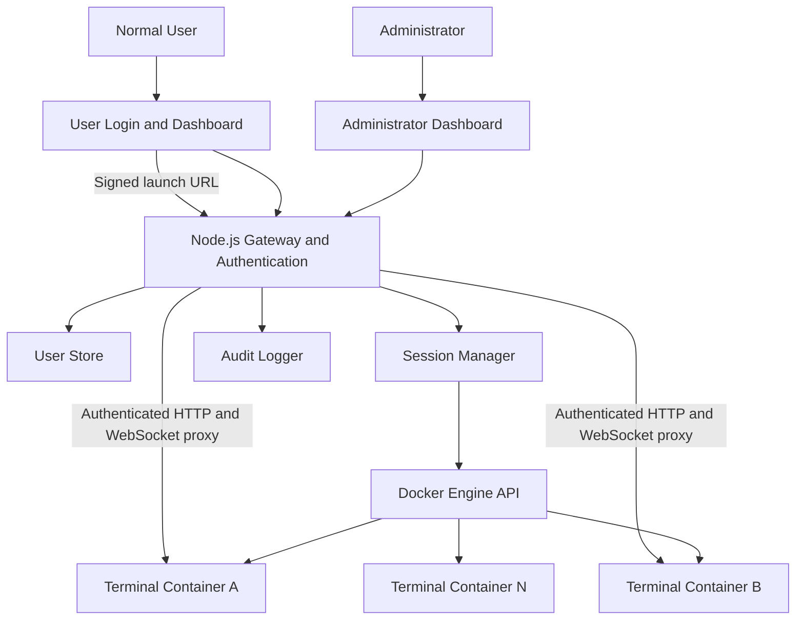

<div align="center">

# 🔐 Secure, Authenticated Browser-Based Terminal Access

**A multi-user browser terminal platform with authenticated dashboards, one-time signed launch links, and isolated Docker terminal containers.**


</div>

---

## Table of contents

- [Overview](#overview)
- [Problem statement](#problem-statement)
- [Features](#features)
- [Technology stack](#technology-stack)
- [System architecture](#system-architecture)
- [How it works](#how-it-works)
- [Security design](#security-design)
- [Project structure](#project-structure)
- [Prerequisites](#prerequisites)
- [Installation and configuration](#installation-and-configuration)
- [Running the application](#running-the-application)
- [Using the dashboards](#using-the-dashboards)
- [API reference](#api-reference)
- [Testing and verification](#testing-and-verification)
- [Configuration reference](#configuration-reference)
- [Known limitations](#known-limitations)
- [Future enhancements](#future-enhancements)
- [Troubleshooting](#troubleshooting)
- [Responsible use](#responsible-use)

---

## Overview

Secure, Authenticated Browser-Based Terminal Access is a multi-user web application that allows learners to access individual command-line environments through a browser. Instead of exposing every terminal directly to the host network, the application places a trusted Node.js gateway between users and their terminal containers.

The application provides two separate dashboards:

- **Administrator dashboard:** create and manage user accounts, create sessions for enabled users, revoke sessions, review audit events, and adjust the launch-token lifetime.
- **Normal-user dashboard:** sign in, create named terminal sessions, open a browser terminal, view personal session status and expiry, revoke personal sessions, change a password, and log out.

Each terminal session is backed by its own Docker container running `ttyd`. The gateway owns the session-to-container mapping and checks authorization before proxying terminal HTTP traffic or WebSocket connections.

> **Project status:** Working academic prototype. The administrator-to-user workflow and normal-user terminal creation/opening have been manually verified in the local Docker deployment. Automated tests and manual checks provide useful evidence, but this project has not undergone a formal penetration test or production security audit.

## Problem statement

Browser-based coding labs need to provide convenient shell access without giving every learner a directly exposed terminal service. Directly publishing terminal ports, sharing credentials, or failing to separate user sessions can create security and operational problems.

This project addresses those concerns through a gateway-mediated approach:

- Users authenticate through a web dashboard.
- Administrators control account creation and enablement.
- Each terminal session receives a separate container.
- Short-lived, signed launch credentials are redeemed once.
- The gateway validates access before forwarding HTTP or WebSocket traffic.
- Session ownership is checked on the server, not trusted from browser input.
- Session lifecycle events are recorded for review.

## Features

### Administrator

- Dedicated administrator login at `/admin`.
- Create ordinary user accounts with username, display name, and password.
- View registered users and enable or disable accounts.
- Create terminal sessions for enabled users.
- View session records and revoke sessions.
- View a bounded list of recent audit events.
- Change the launch-token lifetime for future launch links.

### Normal user

- Dedicated login page at `/login`.
- Personal dashboard at `/dashboard`.
- Create named terminal sessions.
- Select an approved duration: 15, 30, 60, or 120 minutes.
- Open a session in the browser through a signed launch URL.
- View personal sessions and their status/expiry.
- Revoke owned sessions.
- Change password after verifying the current password.
- Log out.

### Terminal and gateway

- One Docker terminal container per session.
- Browser terminal powered by `ttyd`.
- HMAC-SHA-256 signed launch and session tokens.
- One-time launch-token redemption to prevent replay.
- Authentication for HTTP requests and WebSocket upgrades.
- Session expiry and revocation checks.
- JSON Lines audit logging.
- Gateway health endpoint at `/healthz`.

## Technology stack

| Technology | Purpose |
|---|---|
| Node.js | HTTP gateway, authentication, APIs, proxying, and session orchestration |
| JavaScript (CommonJS) | Application implementation |
| Docker Engine API | Create, start, inspect, stop, and remove terminal containers |
| Docker Compose | Run the gateway and define networks, volumes, and limits |
| `ttyd` | Provide browser-accessible terminal sessions |
| HTML, CSS, JavaScript | Administrator and normal-user dashboards |
| HMAC-SHA-256 | Sign and verify terminal access tokens |
| Node.js `crypto` | Password hashing support, random identifiers, token signatures, and comparisons |
| JSON | Local user account store |
| JSON Lines (JSONL) | Structured audit log |
| Node.js built-in test runner | Automated tests |

User passwords are stored as salted `scrypt` hashes by the user store. Plain-text passwords are not stored in `data/users.json`.

## System architecture



### Network layout

```text
Browser
   |
   | HTTP :8080
   v
Node.js terminal-gateway
   |        |             |
   |        |             +--> Local user store (./data)
   |        +----------------> Audit log (./logs)
   |
   +--> Docker Engine API
           |
           +--> terminal container A (ttyd :7681)
           +--> terminal container B (ttyd :7681)
           +--> terminal container N (ttyd :7681)

Gateway and terminal containers communicate through
the Docker terminal-internal network.
Only the gateway port is published to the host.
```

The Docker Compose configuration publishes port `8080` for the gateway. Individual terminal containers do not receive host port bindings. The gateway connects to them over the internal Docker network.

## How it works

### 1. Administrator creates a user

The administrator signs in and creates a normal user account. The account is stored locally with a salted password hash. The administrator can later enable or disable the account.

### 2. User signs in

The user signs in through `/login`. The gateway checks the account credentials and enabled status, then issues an HttpOnly, SameSite=Strict authentication cookie and a CSRF token for write operations.

### 3. User creates a terminal session

The user selects a session name and an approved duration. The gateway creates a session record and asks the session manager to create a dedicated Docker container. The session owner is assigned by the server from the authenticated user account.

### 4. Gateway creates a launch URL

The gateway creates a short-lived signed launch token. The token contains the session identity, expiry, and a random token identifier. The browser uses the launch URL to open the terminal.

### 5. Token is redeemed

The gateway validates the signature, token type, expiry, and session state. It consumes the launch identifier once, then redirects the browser to a clean URL and issues an HttpOnly terminal-session cookie.

### 6. Terminal traffic is proxied

The browser sends authenticated HTTP requests and WebSocket upgrades to the gateway. The gateway validates the session and forwards allowed traffic to the private `ttyd` container.

### 7. Session ends

A session can become unavailable through expiry or explicit revocation. The session manager stops and removes its Docker container. The gateway also closes tracked live WebSocket connections when a session is terminated.

## Security design

| Control | Implementation |
|---|---|
| Password storage | Salted `scrypt` password hashes |
| Administrator and user authentication | Separate dashboard cookies and server-side session maps |
| Cookie protection | HttpOnly and SameSite=Strict; Secure attribute is configurable |
| CSRF protection | Write requests require the per-login CSRF token |
| Account status | Disabled users are rejected at login and on protected user API requests |
| User session ownership | Server assigns `ownerId`; users can list/revoke only their own sessions |
| Launch credentials | HMAC-SHA-256 signed tokens with expiry |
| Replay prevention | Launch token identifier can be consumed only once while stored in the gateway process |
| HTTP authorization | Gateway authenticates before proxying terminal requests |
| WebSocket authorization | Gateway validates credentials and allowed Origin before connecting upstream |
| Network exposure | Only gateway port is published; terminal ports remain internal |
| Container user | Terminal runs as UID/GID `1000:1000` |
| Container privileges | Capabilities dropped; `no-new-privileges` enabled |
| Filesystem | Terminal root filesystem is read-only |
| Resource limits | Terminal defaults: 256 MiB memory, 0.5 CPU, 128 PIDs |
| Temporary storage | `/tmp` uses a 64 MiB `noexec,nosuid` tmpfs |
| Audit | Structured JSONL events for authentication and session lifecycle actions |

### Important trust boundary

The gateway mounts the Docker socket so it can create and manage terminal containers. Access to the Docker socket is highly privileged and can effectively provide control over the host. The socket must remain available only to the trusted gateway component and must never be mounted into learner terminal containers.

The Compose file currently includes `group_add: ["0"]` for the local Docker Desktop environment. Treat this as a development workaround, not a production security recommendation.

## Project structure

```text
Secure, Authenticated Terminal Access/
├── src/
│   ├── multi-user-gateway.js   # Main gateway, dashboard APIs, auth and proxy
│   ├── gateway.js              # Earlier gateway implementation
│   ├── admin-store.js           # Local user store and password hashing
│   ├── session-manager.js       # Docker terminal lifecycle
│   ├── session-store.js         # In-memory session and replay state
│   ├── docker-client.js         # Docker Engine API client
│   └── token.js                 # Token signing, verification and URL helpers
├── public/
│   ├── admin.html               # Administrator dashboard
│   ├── admin.js
│   ├── admin.css
│   ├── user.html                # Normal-user login/dashboard
│   └── user.js
├── scripts/
│   ├── create-admin.js          # Create the initial administrator
│   ├── benchmark.js
│   ├── package-check.js
│   ├── package-project.ps1
│   └── verify-paths.js
├── test/
│   ├── admin-store.test.js
│   ├── gateway.test.js
│   ├── isolation.test.js
│   ├── session-expiry.test.js
│   └── token.test.js
├── docs/
│   └── design.md
├── data/                        # Local user database; do not publish
├── logs/                        # Local audit logs; do not publish
├── .env                         # Local secrets; do not publish
├── .env.example                 # Safe configuration template
├── Dockerfile
├── docker-compose.yml
├── package.json
└── README.md
```

## Prerequisites

- Windows 10/11, macOS, or Linux.
- Node.js 20 or newer.
- npm.
- Docker Desktop (Windows/macOS) or Docker Engine (Linux).
- Docker Compose v2.
- Docker Engine running before starting the application.

Verify the tools:

```powershell
node --version
npm --version
docker --version
docker compose version
docker info
```

On Windows, start Docker Desktop and wait until the engine is ready.

## Installation and configuration

### 1. Extract the project

Extract the project folder and open PowerShell in that directory.

### 2. Create the environment file

```powershell
Copy-Item .env.example .env
```

Generate two different random secrets:

```powershell
node -e "console.log(require('crypto').randomBytes(32).toString('hex'))"
```

Run the command twice. Put one value in `TERMINAL_TOKEN_SECRET` and the other in `ADMIN_KEY` in `.env`. Each secret must be at least 32 characters. Do not use the same value for both.

### 3. Check the terminal network name

The `TERMINAL_NETWORK` value must match the Docker Compose network name. The default example is:

```text
secureauthenticatedterminalaccess_terminal-internal
```

If Docker Compose uses a different project name, inspect the actual network:

```powershell
docker network ls
```

Update `TERMINAL_NETWORK` in `.env` if required.

### 4. Create the first administrator

The user store is persisted in `data/users.json`. Create an administrator from PowerShell:

```powershell
npm run create-admin -- admin "replace-this-with-a-long-unique-password" "Console Administrator"
```

Use a unique password of at least 12 characters. Replace the example password before running the command. Do not put real credentials in source control, screenshots, or documentation.

The command creates the administrator account. It does not start the gateway.

## Running the application

Build and start the gateway:

```powershell
docker compose up -d --build
```

Check container status:

```powershell
docker compose ps
```

View gateway logs:

```powershell
docker compose logs -f terminal-gateway
```

Check the health endpoint:

```powershell
Invoke-WebRequest http://localhost:8080/healthz
```

A healthy response returns HTTP 200 with `ok`.

### Dashboard URLs

| Area | URL |
|---|---|
| Administrator login/dashboard | `http://localhost:8080/admin` |
| Normal-user login | `http://localhost:8080/login` |
| Normal-user dashboard | `http://localhost:8080/dashboard` |
| Health check | `http://localhost:8080/healthz` |

### Stop the application

```powershell
docker compose down
```

This stops and removes the Compose-managed gateway container and network. The bind-mounted `data` and `logs` directories remain on the host. Terminal containers are created separately through the Docker Engine API, so after stopping the gateway, inspect for any remaining project-managed terminal containers before assuming every session container has been removed.

To start it again:

```powershell
docker compose up -d
```

Use `docker compose up -d --build` after changing application code or the Dockerfile.

> Do not run `npm start` at the same time as the Docker Compose gateway when both are configured to use port 8080. The port can only be bound by one process at a time.

## Using the dashboards

### Administrator workflow

1. Open `http://localhost:8080/admin`.
2. Sign in with the administrator account created during setup.
3. Open the Users section and create a normal user.
4. Enable or disable user accounts as required.
5. Review sessions and security events.
6. Revoke a session when access should end.

### Normal-user workflow

1. The administrator creates and enables the account.
2. Open `http://localhost:8080/login`.
3. Sign in using the assigned username and password.
4. Open the dashboard at `/dashboard`.
5. Create a named terminal session and select 15, 30, 60, or 120 minutes.
6. Select Open to launch the browser terminal.
7. Return to the dashboard to view or revoke personal sessions.
8. Use the password-change option to update the account password.

A normal user should only be able to view and revoke sessions owned by that account. The gateway enforces this using the authenticated account's server-side user ID.

## API reference

The browser dashboards use the following application routes. Dashboard write requests require the relevant authenticated cookie and CSRF token.

### Normal-user API

| Method | Route | Purpose |
|---|---|---|
| `POST` | `/api/auth/login` | Authenticate a normal user |
| `POST` | `/api/auth/logout` | End the current normal-user login |
| `GET` | `/api/user/me` | Get the current user |
| `GET` | `/api/user/sessions` | List the current user's sessions |
| `POST` | `/api/user/sessions` | Create a personal terminal session |
| `DELETE` | `/api/user/sessions/{uuid}` | Revoke an owned session |
| `PATCH` | `/api/user/password` | Change the current user's password |

### Administrator dashboard API

| Method | Route | Purpose |
|---|---|---|
| `POST` | `/api/admin/login` | Authenticate an administrator |
| `POST` | `/api/admin/logout` | End the administrator login |
| `GET` | `/api/admin/me` | Get the current administrator |
| `GET` | `/api/admin/overview` | Get dashboard counts and recent activity |
| `GET` | `/api/admin/users` | List users |
| `POST` | `/api/admin/users` | Create a user |
| `PATCH` | `/api/admin/users/{uuid}` | Update supported user fields, including enabled status |
| `GET` | `/api/admin/sessions` | List sessions |
| `POST` | `/api/admin/sessions` | Create a session for an enabled user |
| `DELETE` | `/api/admin/sessions/{uuid}` | Revoke a session |
| `GET` | `/api/admin/audit-logs` | Read recent audit events |
| `GET` | `/api/admin/settings` | Read runtime settings |
| `PATCH` | `/api/admin/settings` | Update launch-token lifetime |

### Gateway/admin-key API

The gateway also contains a separate `/admin/` API protected by the `x-admin-key` header:

| Method | Route | Purpose |
|---|---|---|
| `POST` | `/admin/sessions` | Create a terminal session |
| `GET` | `/admin/sessions/{uuid}` | Read a session record |
| `DELETE` | `/admin/sessions/{uuid}` | Revoke a session |
| `GET` | `/healthz` | Health check |

The `ADMIN_KEY` is not the administrator dashboard password. Keep it secret and do not expose it to normal users or place it in frontend code.

## Testing and verification

Run commands from the project directory.

### Automated tests

```powershell
npm test
```

Run focused test groups:

```powershell
npm run test:security
npm run test:isolation
npm run test:integration
```

Check JavaScript syntax:

```powershell
npm run check
```

Check packaging paths and secret exclusions:

```powershell
npm run package:check
```

The package check is expected to reject a project tree containing `.env` or `.env.local`. Run it against a clean submission copy that excludes secrets, live logs, and `node_modules`. Do not disable this safeguard to make packaging pass.

### Manual verification checklist

- [x] Administrator can create a normal user.
- [x] A created normal user can log in.
- [x] A normal user can create and open their own browser terminal.
- [ ] Two users cannot view or revoke each other's sessions.
- [ ] A disabled user is rejected by login and protected user APIs.
- [ ] A normal-user cookie cannot access administrator APIs.
- [ ] Password change rejects an incorrect current password and invalidates existing user logins.
- [ ] Revoked and expired sessions cannot be reused.
- [ ] Corresponding Docker containers are stopped and removed after termination.

The first three items were manually confirmed in the local deployment. Complete the remaining checks before presenting the security properties as fully verified.

### Test-scope note

Automated tests exercise token handling, gateway behavior, session-store expiry, user-store behavior, and simulated isolation paths. Tests that use simulated upstream servers do not, by themselves, prove isolation between multiple real Docker containers. A simulated-clock expiry test does not replace a live Docker-backed expiry test. Record the exact output from the current machine when reporting test results.

## Configuration reference

Use `.env.example` as the source of truth for available variables. The main multi-user gateway reads these settings:

| Variable | Purpose | Example |
|---|---|---|
| `PORT` | Gateway HTTP port | `8080` |
| `TERMINAL_TOKEN_SECRET` | HMAC signing secret, minimum 32 characters | Random 64-character hex value |
| `ADMIN_KEY` | Separate admin API key, minimum 32 characters | Different random value |
| `SESSION_TTL_SECONDS` | Default terminal session duration | `3600` |
| `LAUNCH_TTL_SECONDS` | Default launch-token lifetime | `60` |
| `MAX_ACTIVE_SESSIONS` | Maximum active sessions in this gateway process | `10` |
| `TERMINAL_IMAGE` | Docker image used for terminal containers | `tsl0922/ttyd:1.7.7` |
| `TERMINAL_NETWORK` | Internal Docker network name | Compose network name |
| `TERMINAL_COMMAND` | Command run inside the terminal container | `ttyd -W --max-clients 1 bash` |
| `AUDIT_LOG_PATH` | Audit log file | `logs/terminal-access.jsonl` |
| `USER_STORE_PATH` | User database file | `data/users.json` |
| `DOCKER_SOCKET` | Docker Engine socket inside gateway | `/var/run/docker.sock` |
| `ALLOWED_ORIGINS` | Allowed browser origin(s) | `http://localhost:8080` |
| `COOKIE_SECURE` | Whether dashboard cookies use Secure | `false` for local HTTP |
| `FRAME_ANCESTORS` | Content Security Policy frame-ancestors value | `'self'` |

For local HTTP development, `COOKIE_SECURE=false` is used in the example configuration. A real deployment should use HTTPS and secure cookies. The runtime settings page can change the launch-token lifetime for subsequently generated launch URLs.

## Known limitations

This is an academic prototype and should not be exposed as a production multi-tenant service without further hardening.

1. **In-memory terminal session state:** `MemorySessionStore` keeps sessions and consumed launch-token identifiers in process memory. A gateway restart loses this state. It is not suitable for multiple gateway replicas.
2. **In-memory dashboard logins:** administrator and normal-user dashboard login sessions are held in memory and are invalidated when the gateway restarts.
3. **Local user database:** user records persist in `data/users.json`, but the current file-backed store is intended for a single local instance, not concurrent distributed writers.
4. **Docker socket privilege:** the gateway's Docker socket access is highly privileged. The local Compose group workaround is not a production isolation boundary.
5. **Network egress:** the internal Docker network limits direct exposure, but a DNS `SERVFAIL` observation alone does not prove complete outbound network isolation.
6. **Test coverage:** simulated upstream tests and local manual checks are not a substitute for real multi-container adversarial testing, penetration testing, or a security audit.
7. **Operational cleanup:** because terminal containers are created through the Docker API rather than as Compose services, operators should verify remaining managed containers during shutdown and recovery procedures.

## Future enhancements

- Replace in-memory session and replay state with Redis or another durable store using atomic operations.
- Persist dashboard authentication sessions securely or use a dedicated identity provider.
- Add automated end-to-end tests using multiple real Docker terminal containers.
- Add a robust startup reconciliation process for orphaned managed containers.
- Strengthen Docker isolation with a dedicated runtime, seccomp/AppArmor profiles, and carefully controlled egress.
- Add HTTPS termination, secure cookie defaults, secret rotation, and centralized audit collection.
- Add role-based permissions, configurable quotas, and administrator audit export.
- Add monitoring and alerting for repeated authentication failures and container lifecycle errors.

## Troubleshooting

### Port 8080 is already in use

Check whether Docker Compose is already running:

```powershell
docker compose ps
```

If the gateway is already running in Docker, use the browser rather than starting a second copy with `npm start`.

### Gateway is unhealthy

Inspect logs:

```powershell
docker compose logs --tail 100 terminal-gateway
```

Check that Docker Desktop is running, the required environment variables are configured, and the terminal network name matches the Compose network.

### Terminal container cannot start

Check gateway logs and Docker container status:

```powershell
docker compose logs --tail 100 terminal-gateway
docker ps -a
```

Confirm that the configured terminal image is available and the gateway can access the Docker Engine socket.

### Administrator login fails

Confirm that the administrator account exists in the same `data/users.json` file mounted into the running container. The Compose file maps the host `./data` directory to `/app/data`.

### Dashboard page is missing or returns an error

Rebuild the image so the latest frontend files are copied into it:

```powershell
docker compose up -d --build terminal-gateway
```

The Dockerfile copies the `public` directory into `/app/public`.

### Secret validation error

Both `TERMINAL_TOKEN_SECRET` and `ADMIN_KEY` must be configured and at least 32 characters long. They must be different values.

## Responsible use

Use this project only in systems and environments where you have authorization to provide terminal access. Treat terminal commands as untrusted workloads. Do not expose the Docker socket, secrets, audit logs, or local user database to learners. Before using the application with real users or untrusted workloads, complete the production-hardening work described above.
